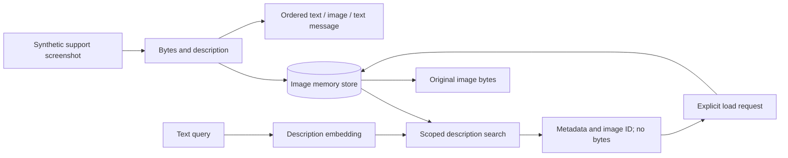

# Image-aware agent memory

Keep support screenshots available across agent turns without placing the image bytes in every search result. Store the original image together with a short description, search that description, and load the original only when it is needed. Ordered messages retain the relationship between text and visual evidence.

This project has two explicit execution modes:

| Mode | Storage and search | Dependencies |
| --- | --- | --- |
| Local demonstration | SQLite stores PNG/JPEG/WebP bytes and description vectors. A deterministic 128-dimensional token hash with cosine similarity illustrates retrieval mechanics; it is not a learned semantic embedding or pixel search. | `requirements.txt` |
| Native Oracle workflow | Oracle AI Agent Memory 26.8 persists image DOCUMENT records in Oracle AI Database and performs vector retrieval using the configured text embedder. | `requirements-oracle.txt`, a POSIX runtime, Oracle AI Database, and a configured model provider |



## Run the local demonstration

Use Python 3.11 or later. PowerShell commands:

```powershell
python -m venv .venv
.\.venv\Scripts\python -m pip install -r requirements.txt
.\.venv\Scripts\python -B app.py --port 8882
```

Open <http://127.0.0.1:8882/>. Search for `checkout timeout`, then select **Load original image**. Search results and the ordered message endpoint omit image bytes. The image endpoint hydrates the exact standalone image only after the explicit request. The server binds to loopback and contains only generated evidence. Local data persists in `.local/memory.sqlite3`; use `--database PATH` to select a different file.

The demo uses fixed synthetic user and agent scopes. Scope filters are retrieval filters, not authentication. Do not expose this server or use it as a production authorization boundary. The local implementation does not implement TTL, schema upgrades, caption generation or automatic memory extraction.

## Run against Oracle AI Database

The native image decoder requires Linux, macOS, WSL or a Linux container; the upstream notebook explicitly excludes Windows. Run the following inside that POSIX environment:

```bash
python -m venv .venv
. .venv/bin/activate
python -m pip install -r requirements-oracle.txt
export DB_USER='YOUR_DATABASE_USER'
export DB_PASSWORD='YOUR_DATABASE_PASSWORD'
export DB_DSN='YOUR_DATABASE_DSN'
export MODEL_PROVIDER_API_KEY='YOUR_PROVIDER_KEY'
export MEMORY_EMBEDDING_MODEL='YOUR_EMBEDDING_MODEL'
export MEMORY_LLM_MODEL='YOUR_LLM_MODEL'
export MEMORY_EMBEDDING_DIMENSION='1536'
export MEMORY_STORE_ID='IMGMEMORY'
python -B native.py --create-schema
```

Use a development schema whose database user may create the managed memory tables. Subsequent runs can omit `--create-schema` to require the existing schema. Match `MEMORY_EMBEDDING_DIMENSION` to the selected embedding model and the existing schema. Optional wallet settings are `DB_WALLET_LOCATION` and `DB_WALLET_PASSWORD`. Supply credentials through the environment; do not commit them.

The command creates a new uniquely named synthetic image and thread on each run. It verifies byte omission, description search, standalone byte round trip, ordered message image hydration, description updates, and the managed DOCUMENT row's byte length. Supplied captions keep image caption generation unnecessary; automatic extraction and context summaries are disabled. Text embedding requests still use the configured provider. No application-level deletion or destructive preflight SQL runs.

Native database connectivity, schema creation, model service calls and POSIX image decoding require the configured environment and are not exercised by the offline tests. The contract test verifies native method signatures against the installed SDK with mocked service results; it is not an integration test.

## CODE MAP

| File | Responsibility and connections |
| --- | --- |
| `memory.py` | Generates synthetic evidence, validates image formats, computes local vectors, and persists scoped standalone images and ordered messages. Search SQL excludes the payload column. Exact-ID byte hydration is separate. |
| `app.py` | Seeds local evidence and serves the loopback search page, explicit image load and ordered-message JSON using `LocalMemory`. |
| `native.py` | Builds the configured Oracle client and runs the native storage/search/hydration/message workflow, followed by a read-only DOCUMENT inspection. |
| `test_memory.py` | Tests persistence, scopes, format validation, byte omission, message ordering, HTTP behavior, and the native SDK API contract. |
| `requirements.txt` | Pins the local image library. |
| `requirements-oracle.txt` | Adds the native Oracle SDK to the local requirements. |
| `.gitignore` | Excludes environments, credentials, local database files, generated images and caches. |

## Verify

```powershell
.\.venv\Scripts\python -B -m unittest -v
```

The native contract test is skipped when only local dependencies are installed. Install `requirements-oracle.txt` to run it too. The tests use temporary databases and never require real keys or a database connection.

## Upstream implementation and API documentation

- [Oracle AI Developer Hub image-memory notebook](https://github.com/oracle-devrel/oracle-ai-developer-hub/blob/main/notebooks/agent_memory/oracle_agent_memory_image_aware_memory.ipynb)
- [Image and multimodal message APIs](https://docs.oracle.com/en/database/oracle/agent-memory/26.8/guide/int-use-images.html)

The native workflow follows the public 26.8 API. The SQLite implementation is an independent educational demonstration and does not claim Oracle feature parity or retrieval quality.
